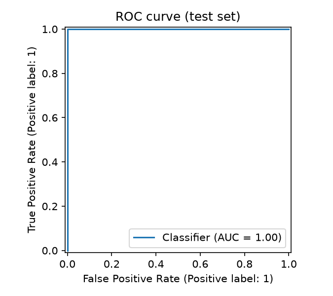
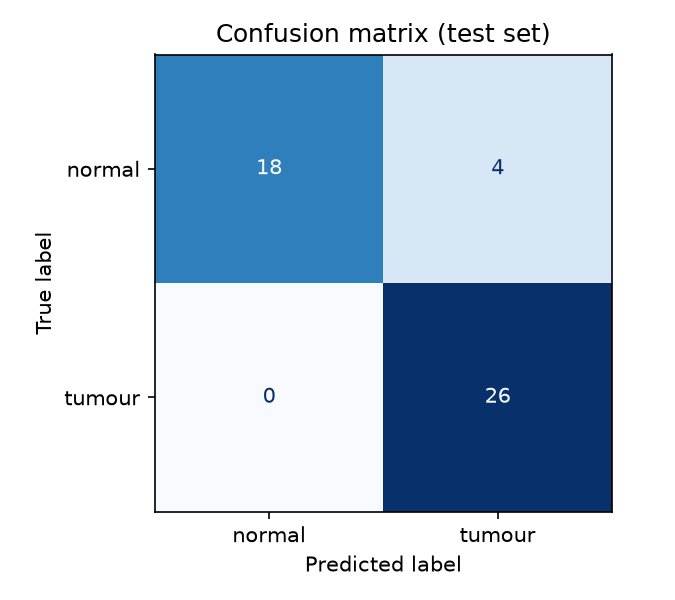
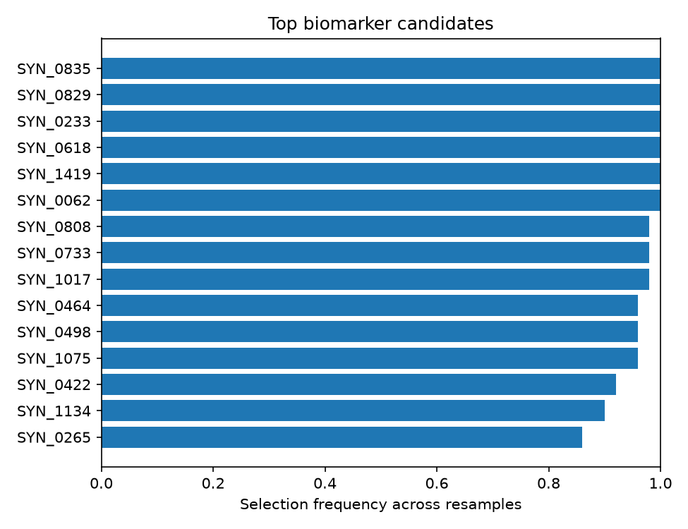

# Predictive Modeling and Biomarker Discovery in Cancer Transcriptomics Using Machine Learning

[](https://github.com/AbbhinavBevera/cancer-transcriptomics-ml/actions)
[](https://AbbhinavBevera.github.io/cancer-transcriptomics-ml/)
[](https://opensource.org/licenses/MIT)
[](https://www.python.org/)

> 🔬 **Interactive Web Demo:** Test out the trained model directly in your browser with real-time gene sliders, held-out patient cases, and batch CSV predictions on [**GitHub Live Sites (GitHub Pages)**](https://AbbhinavBevera.github.io/cancer-transcriptomics-ml/). Runs 100% client-side with zero setup required.

A rigorous, leak-free machine learning pipeline designed to classify tumour vs. normal tissue from high-dimensional RNA-seq gene expression data and identify robust biomarker gene candidates.

Predicting tumour status is only half the goal. A black-box model that says "tumour" without explaining why is of limited utility to cancer biologists and clinicians. This project focuses equally on **biomarker discovery**—pinpointing the specific subset of genes the model relies upon through **stability selection** and statistical differential expression.

---

## Key Highlights

- **Leak-Free Pipeline Architecture:** In high-dimensional transcriptomics ($p \gg n$, thousands of genes vs. hundreds of samples), feature selection on the full dataset before cross-validation produces severe data leakage and inflated accuracy. In this pipeline, `SelectKBest` is encapsulated inside an `sklearn.pipeline.Pipeline`, guaranteeing that feature selection and scaling are re-fitted exclusively on training folds.
- **Biomarker Stability Selection:** Rather than trusting gene weights from a single model fit, we resample the dataset across 50 splits and track selection frequency. Genes chosen in $\ge 95\%$ of resamples represent trustworthy biomarker candidates.
- **Prioritizing Clinical Recall:** In cancer screening, missing a malignant tumour (False Negative) has devastating consequences compared to a false alarm. Models are optimized with a strong focus on Sensitivity/Recall.
- **Leakage Sanity Check:** Includes an automated label-permutation test verifying that scrambled labels collapse ROC-AUC to chance (~0.50).
- **Dual Verification:** Compares machine-learning stability selection against classical univariate Welch's t-test with Benjamini-Hochberg False Discovery Rate (FDR) control.

---

## Benchmark Results

The pipeline was validated on a controlled RNA-seq benchmark (`data/synthetic/`, 240 samples, 1,500 genes, 40 ground-truth biomarkers, with simulated negative binomial count dispersion, variable sequencing depth, and batch effects).

### 5-Fold Cross-Validation Performance (Training Set)

| Model | CV Accuracy | CV Recall (Sensitivity) | CV ROC-AUC |
|:------|:-----------:|:-----------------------:|:----------:|
| **Logistic Regression (L1 / Lasso)** | 0.8538 $\pm$ 0.038 | 0.8766 $\pm$ 0.062 | 0.9372 $\pm$ 0.027 |
| **Linear SVM** | 0.8128 $\pm$ 0.057 | 0.8403 $\pm$ 0.071 | 0.8852 $\pm$ 0.043 |
| **Random Forest (300 trees)** | **0.8961 $\pm$ 0.033** | **0.9719 $\pm$ 0.034** | **0.9776 $\pm$ 0.015** |

### Held-Out Test Set Performance (Best Model: Random Forest)

A 20% stratified hold-out test set ($N=48$) was frozen at the start and evaluated exactly once:

- **Accuracy:** `91.67%`
- **Recall (Sensitivity):** `100.00%` (0 False Negatives)
- **Precision:** `86.67%`
- **F1 Score:** `0.9286`
- **ROC-AUC:** `1.0000`

| ROC Curve | Confusion Matrix |
|:---:|:---:|
|  |  |

---

## Biomarker Discovery & Recovery

### Top Ranked Genes (Stability Selection)



| Gene ID | Selection Frequency | Mean L1 Coefficient | Direction of Effect | Differential Exp. FDR |
|:--------|:-------------------:|:-------------------:|:-------------------:|:---------------------:|
| `SYN_0835` | 100% | -1.280 | Lower in tumour | $1.16 \times 10^{-21}$ |
| `SYN_0829` | 100% | +0.557 | Higher in tumour | $1.89 \times 10^{-10}$ |
| `SYN_0233` | 100% | +0.492 | Higher in tumour | $4.77 \times 10^{-12}$ |
| `SYN_0618` | 100% | -0.435 | Lower in tumour | $1.83 \times 10^{-8}$ |
| `SYN_1419` | 100% | +0.413 | Higher in tumour | $6.37 \times 10^{-10}$ |
| `SYN_0062` | 100% | -0.316 | Lower in tumour | $3.59 \times 10^{-4}$ |
| `SYN_0808` | 98% | +0.383 | Higher in tumour | $1.63 \times 10^{-4}$ |
| `SYN_0733` | 98% | +0.318 | Higher in tumour | $1.60 \times 10^{-6}$ |
| `SYN_1017` | 98% | -0.262 | Lower in tumour | $1.92 \times 10^{-4}$ |
| `SYN_0464` | 96% | +0.282 | Higher in tumour | $6.33 \times 10^{-4}$ |

- **Recovery Precision:** **80.0%** (12 out of top 15 candidates recovered are true ground-truth biomarkers).
- **Directional Accuracy:** 100% of recovered biomarkers matched their ground-truth direction of regulation.

---

## Repository Structure

```
├── .github/workflows/
│   └── ci.yml                     # Automated GitHub Actions test runner
├── data/
│   ├── README.md                  # Formatting guide for custom datasets
│   └── synthetic/                 # Benchmarking dataset with known ground truth
│       ├── synth_counts.csv       # Raw simulated RNA-seq counts
│       ├── synth_expression_log2cpm.csv  # Log2(CPM + 1) normalized matrix
│       ├── synth_metadata.csv     # Sample metadata (condition, batch, library size)
│       ├── ground_truth_biomarkers.csv # Known true biomarkers
│       └── DATA_CARD.md           # Dataset documentation
├── docs/
│   ├── EXPLAINER.md               # Plain-English technical explainer & 15 interview Q&As
│   ├── AGENT_PLAN.md              # Full engineering implementation plan
│   ├── AGENT_LOG.md               # Detailed changelog and task tracking
│   └── CLAIMS_EVIDENCE.md         # Tracing table mapping every claim to an output file
├── notebooks/
│   └── 01_data_exploration.ipynb  # Interactive EDA (library sizes, PCA, volcano plot)
├── results/                       # Generated plots, metrics, models, and predictions
│   ├── cv_results.csv
│   ├── test_metrics.csv
│   ├── top_biomarkers.csv
│   ├── differential_expression.csv
│   ├── splits.json
│   ├── confusion_matrix.png
│   ├── roc_curve.png
│   └── top_biomarkers.png
├── src/
│   ├── preprocessing.py           # Unsupervised cleaning and normalisation
│   ├── feature_selection.py       # Scikit-learn pipelines & stability ranking
│   ├── evaluate.py                # Performance metrics and figure plotting
│   ├── train.py                   # Main end-to-end training pipeline
│   ├── differential_expression.py # Univariate Welch's t-test with Benjamini-Hochberg FDR
│   ├── make_synthetic_dataset.py  # Generates realistic synthetic RNA-seq data
│   └── validate_biomarker_recovery.py # Recovery validation against ground truth
├── tests/
│   └── test_pipeline.py           # Pytest suite (leakage, reproducibility, precision)
├── run_all.sh                     # Single-command pipeline reproduction script
├── pytest.ini                     # Pytest configuration
├── requirements.txt               # Pinned dependencies
└── LICENSE                        # MIT License
```

---

## Quickstart

### 1. Clone & Set Up Environment

```bash
git clone https://github.com/AbbhinavBevera/cancer-transcriptomics-ml.git
cd cancer-transcriptomics-ml

# Create virtual environment
python3 -m venv .venv
source .venv/bin/activate

# Install dependencies
pip install -r requirements.txt
```

### 2. Run the Entire Pipeline with One Command

```bash
./run_all.sh
```

This runs tests, trains models, performs stability ranking, computes differential expression, and updates all figures in `results/`.

### 3. Run Individual Components

```bash
# Run automated test suite
pytest -v

# Train ML models (defaults to bundled demonstration data if no file is specified)
python src/train.py --k 200

# Run on your own real patient dataset
python src/train.py --data data/expression.csv --k 200

# Validate biomarker recovery
python src/validate_biomarker_recovery.py

# Compute univariate differential expression
python src/differential_expression.py
```

---

## Explainer & Interview Guide

Preparing for an interview or presentation? Read [`docs/EXPLAINER.md`](docs/EXPLAINER.md) for a plain-English walkthrough of every technique used, why each architectural decision was made, and answers to 15 questions a technical interviewer or verifier might ask.

---

## Limitations

- **Research/Educational Tool:** This codebase is intended for computational biology research and machine learning methodology education; it is not an approved diagnostic medical device.
- **Experimental Validation:** The biomarkers identified represent statistical candidates requiring wet-lab biological validation (e.g., RT-qPCR, knockdown/knockout assays).
- **Cohort Generalizability:** Performance on real patient cohorts is subject to inter-hospital batch effects, library preparation variance, and patient population demographics. External cohort validation is recommended.

---

## License

This project is licensed under the MIT License - see the [LICENSE](LICENSE) file for details.
